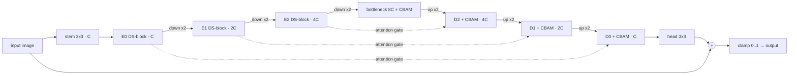

# LUMA: Lightweight Attention-UNet for Real-Time Low-Light Image Enhancement

A small convolutional network (well under 1M parameters) that brightens and cleans dark photos,
designed to run in real time (≥30 FPS at 600×400) on one GPU. It combines **depthwise-separable
convolutions**, **CBAM channel + spatial attention** and **attention gates** on the U-Net skip
connections, and predicts a residual on top of the input.

The project is built to be **reproducible and honest**:
- every number in this README and in the report is produced by a script and stored in `results/`;
- PSNR/SSIM are reported **without GT-mean brightness correction** (corrected scores are kept
  in a separate, labelled table);
- all baselines are re-run through the **same metric code** where possible;
- seeds are fixed, and every run saves its exact config next to its checkpoint and logs.

## Results

The tables below are generated automatically by `src/collect_results.py` from the files in
`results/`. Until the experiments have been run on Colab, this section is empty.

<!-- RESULTS:START -->
_No results yet. Run the notebooks; this section is regenerated by `src/collect_results.py`._

<!-- RESULTS:END -->

## Architecture



- **DS-block**: two depthwise-separable 3×3 convolutions with LeakyReLU and a residual shortcut.
- **CBAM**: channel attention (avg- and max-pooled MLP), then spatial attention (7×7 conv). ECA and SE are drop-in options.
- **Attention gate**: the decoder feature decides how much of each noisy encoder skip feature to use.
- **Global residual**: output = input + predicted residual, clamped to [0, 1].
- Every part can be switched off in `configs/*.yaml` (used by the ablations). C = 16 by default.

Loss: Charbonnier + 0.3·(1−SSIM) + 0.05·VGG-19 perceptual + 0.1·colour angle.
Training: AdamW (lr 2e-4), warmup + cosine schedule, gradient clipping, mixed precision,
256×256 random crops with flips and rotations.

## Run it on Google Colab (free T4 GPU)

| Notebook | What it does | Phase | Time on a T4 |
|---|---|---|---|
| [`00_setup_and_data`](notebooks/00_setup_and_data.ipynb) [](https://colab.research.google.com/github/Asad3404/LUMA/blob/main/notebooks/00_setup_and_data.ipynb) | download + verify all datasets, cache them on Drive | 1 | ~5 min once |
| [`01_train`](notebooks/01_train.ipynb) [](https://colab.research.google.com/github/Asad3404/LUMA/blob/main/notebooks/01_train.ipynb) | train the main model, resumes automatically | 2–3 | a few hours, over 1–2 sessions |
| [`02_evaluate_and_benchmark`](notebooks/02_evaluate_and_benchmark.ipynb) [](https://colab.research.google.com/github/Asad3404/LUMA/blob/main/notebooks/02_evaluate_and_benchmark.ipynb) | metrics, figures, FPS, ONNX, baselines, tables | 4, 5, 7 | ~30–60 min |
| [`03_ablations`](notebooks/03_ablations.ipynb) [](https://colab.research.google.com/github/Asad3404/LUMA/blob/main/notebooks/03_ablations.ipynb) | one ablation per session (11 runs) | 6 | ~1 h each |
| [`04_demo`](notebooks/04_demo.ipynb) [](https://colab.research.google.com/github/Asad3404/LUMA/blob/main/notebooks/04_demo.ipynb) | Gradio web app with a public link + video enhancement | 8 | minutes |

The badges open the `main` branch. Until this work is merged, open the notebooks in Colab with
*File → Open notebook → GitHub*: enter `Asad3404/LUMA` and choose the branch
`claude/attention-unet-low-light-ay0gpv`.

In every notebook: `Runtime → Change runtime type → T4 GPU`, then `Runtime → Run all`.
Everything persistent is saved on your Google Drive:

```
MyDrive/lowlight-attn-unet/
├── datasets/   <name>.zip caches (+ manual/ for hand-downloaded zips)
├── runs/       one folder per experiment: config.yaml, latest.pth, best.pth, logs, TensorBoard, samples
├── baselines/  downloaded baseline weights and code
└── results/    metrics/, benchmark/, figures/, tables/, outputs/, summary.csv
```

The last section of notebook 02 copies the small result files into this repository's
`results/` folder, regenerates the tables above and (optionally) pushes them to GitHub.

## Run locally

```bash
pip install -r requirements.txt
python data/download.py --datasets lol_v1 --data_root ./data_local --cache_dir ./cache
python src/train.py --config configs/base.yaml --opts data.root=./data_local paths.runs=./runs paths.results=./results
python src/evaluate.py --checkpoint runs/ours_lolv1/best.pth --method ours_lolv1 --data_root ./data_local --out results --save_images
python src/benchmark.py --checkpoint runs/ours_lolv1/best.pth --method ours_lolv1 --out results
python src/export.py --checkpoint runs/ours_lolv1/best.pth --method ours_lolv1 --out results
python src/run_baselines.py --data_root ./data_local --out results --cache ./baselines
python src/collect_results.py --results results
python demo/app.py --checkpoint runs/ours_lolv1/best.pth            # web UI at http://localhost:7860
python demo/video.py --checkpoint runs/ours_lolv1/best.pth --webcam # live webcam (local only)
python -m pytest tests -q                                           # 70+ offline tests
```

## Baselines

| Method | Weights used | How it is run |
|---|---|---|
| Zero-DCE | official (`Epoch99.pth`) | architecture re-implemented here with identical layer names; weights load strictly |
| Zero-DCE++ | official (`Epoch99.pth`) | same; run at full resolution (`scale_factor=1`) |
| EnlightenGAN | official, converted to ONNX ([EnlightenGAN-inference](https://github.com/arsenyinfo/EnlightenGAN-inference)) | ONNX Runtime |
| RetinexNet | **unofficial** PyTorch port ([aasharma90/RetinexNet_PyTorch](https://github.com/aasharma90/RetinexNet_PyTorch)); the official release is TensorFlow 1 | port's code + checkpoint |
| Retinexformer | official per-dataset weights | official architecture file + reflect padding to a multiple of 4 |

If a baseline cannot be run (for example a Google Drive quota), the comparison table falls back to
published numbers from [`results/baselines/reported.yaml`](results/baselines/reported.yaml), marked
"reported†".

## Repository layout

```
configs/      base.yaml (main model), lol_v2_*.yaml, ablations/*.yaml + index.yaml
data/         download.py (download, normalise, verify), DATASETS.md (sources, licenses, citations)
src/
  datasets.py       paired/unpaired datasets, crops + flips + rotations
  models/blocks.py  DSConv, ECA, SE, CBAM, attention gate, upsampling
  models/unet_attn.py  configurable Attention-UNet (+ params/MACs printer)
  losses.py         Charbonnier, SSIM, VGG perceptual, colour
  metrics.py        PSNR, SSIM, LPIPS, NIQE, GT-mean correction (supplementary only)
  train.py          AMP, warmup+cosine, grad clipping, auto-resume, TensorBoard
  evaluate.py       per-image + mean metrics -> JSON + summary.csv
  benchmark.py      params, MACs, latency/FPS (FP32/FP16) with proper CUDA sync
  export.py         ONNX export, PyTorch-vs-ONNX check, ONNX Runtime speed
  baselines.py, run_baselines.py   baseline methods through the same pipeline
  figures.py        input | methods | GT with zoomed crops
  collect_results.py  every table, plot, README section and report number
demo/         app.py (Gradio), video.py (video/webcam), make_gif.py
notebooks/    00–04 for Colab
scripts/      sync_results.py (Drive -> repo results/, optional git push)
report/       main.tex + references.bib (numbers injected from results/)
results/      script outputs only
tests/        pytest suite (runs offline on tiny fake data)
```

## Datasets and citations

LOL-v1 ([Wei et al., BMVC 2018](https://daooshee.github.io/BMVC2018website/)), LOL-v2 Real/Synthetic (Yang et al., IEEE TIP 2021),
and DICM, LIME, MEF, NPE, VV for no-reference evaluation. See [`data/DATASETS.md`](data/DATASETS.md) for sources,
licences and full citations. Main method references: U-Net (Ronneberger et al., 2015), Attention U-Net
(Oktay et al., 2018), CBAM (Woo et al., 2018), ECA-Net (Wang et al., 2020), MobileNets (Howard et al., 2017),
Zero-DCE (Guo et al., 2020), Zero-DCE++ (Li et al., 2021), EnlightenGAN (Jiang et al., 2021),
Retinexformer (Cai et al., 2023). The full bibliography is in [`report/references.bib`](report/references.bib).
